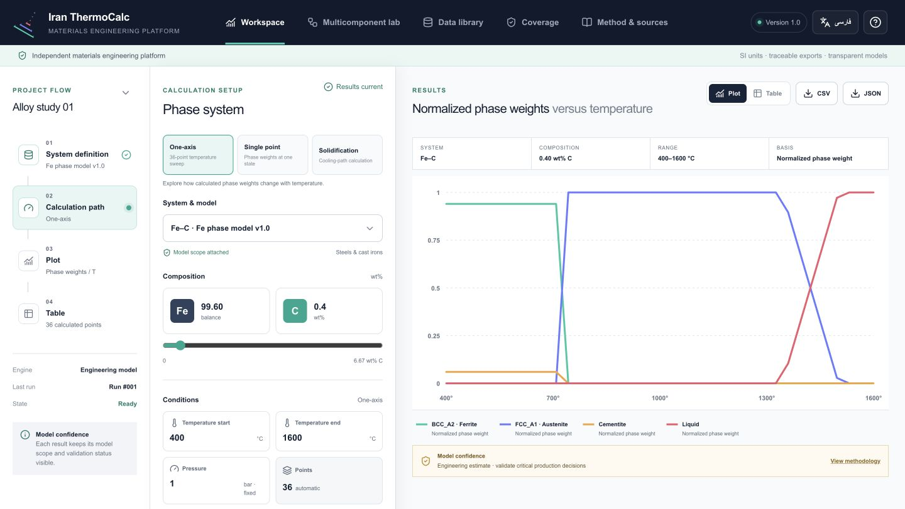
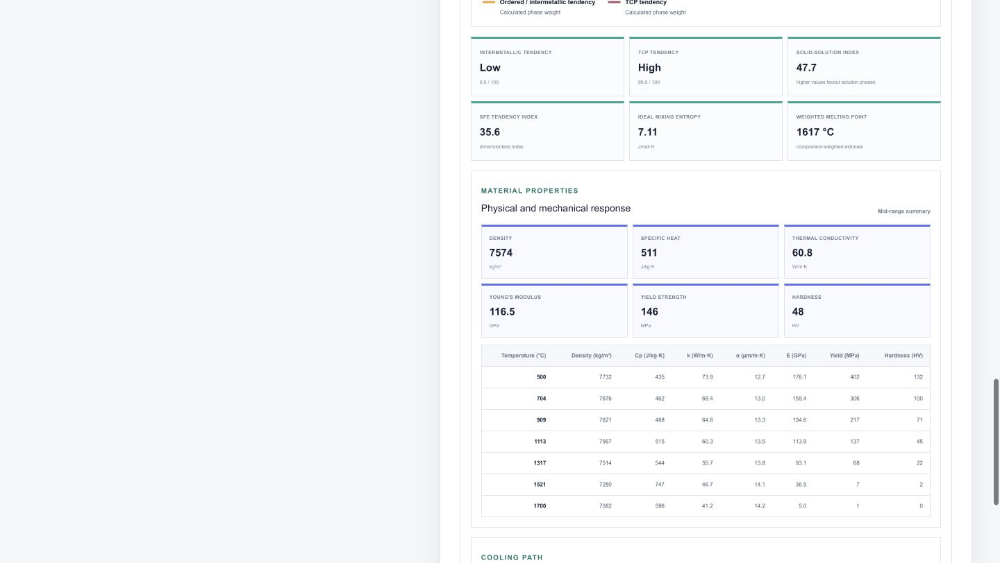
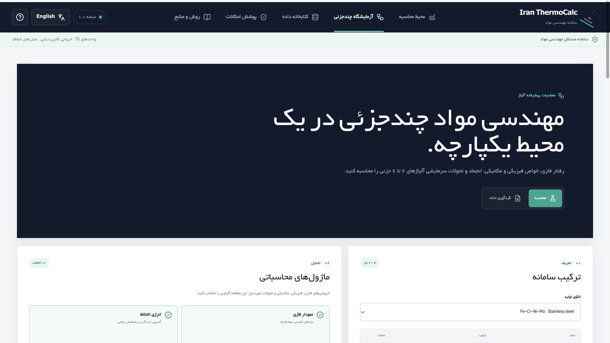
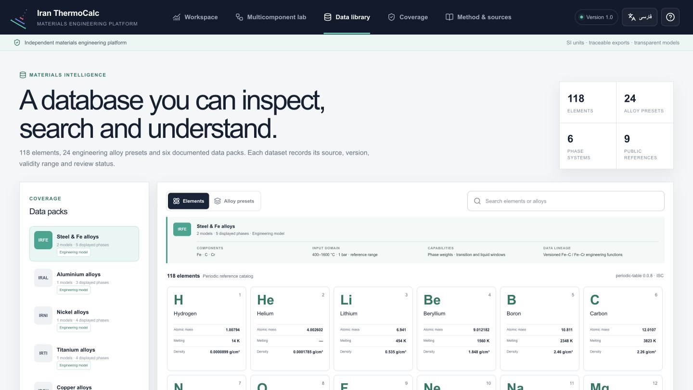

# Iran ThermoCalc

**A bilingual, local-first materials-engineering workbench for alloy screening, phase-behaviour exploration, and property estimation.**

Iran ThermoCalc runs on your own computer. It does not require an API key, account, usage tokens, or a remote solver.



## What it includes

- Interactive binary-system workspace with phase-field visualization
- Deterministic local studies for alloys containing 2–6 elements
- Temperature-dependent phase-behaviour and solidification estimates
- Density, specific heat, thermal conductivity, thermal expansion, Young's modulus, yield strength, and hardness estimates
- Cooling-transformation, solid-solution, intermetallic, TCP, and stacking-fault-energy indicators
- A local reference catalog covering 118 elements and 24 alloy presets
- English and Persian interfaces with right-to-left layout support
- CSV and JSON export with scientific-scope metadata
- Responsive UI for desktop and tablet-sized screens

## Screenshots

| Multicomponent results | Persian interface |
| --- | --- |
|  |  |

| Workspace | Data library |
| --- | --- |
|  |  |

## Requirements

- Windows 10/11, macOS, or Linux
- [Node.js 22.13 or newer](https://nodejs.org/)
- About 1 GB of free disk space for the project and installed packages

You do **not** need Python, Docker, a database server, an API key, or a paid scientific-software license to run the included local screening engine.

## Install and run on Windows

1. Install the current Node.js LTS release from [nodejs.org](https://nodejs.org/).
2. Download this repository with **Code → Download ZIP**, then extract it. Alternatively, clone it with Git.
3. Open PowerShell in the extracted project folder.
4. Run:

```powershell
npm install
npm run build
npm run dev
```

5. Open [http://localhost:3000](http://localhost:3000) in Chrome, Edge, or Firefox.

Leave PowerShell open while using the app. Press `Ctrl+C` to stop it.

For later sessions, open the same project folder and run only:

```powershell
npm run dev
```

## Install and run on macOS or Linux

Install Node.js 22.13 or newer, open Terminal in the project folder, then run:

```bash
npm install
npm run build
npm run dev
```

Open [http://localhost:3000](http://localhost:3000). Press `Control+C` to stop the app.

## Use another port

If port 3000 is already occupied, choose another port.

Windows PowerShell:

```powershell
$env:PORT=3001
npm run dev
```

macOS or Linux:

```bash
PORT=3001 npm run dev
```

Then open [http://localhost:3001](http://localhost:3001).

## Use it from another computer on the same network

When the local server starts, it prints two addresses. Use the **Same Wi-Fi** address on another computer or tablet connected to the same trusted network. The address changes when the host computer changes networks.

If Windows asks whether Node.js may communicate through the firewall, allow access only on trusted private networks.

## Development and verification

```bash
# Source development with hot reload
npm run dev:hot

# Static checks
npm run lint

# Production build and local-engine tests
npm test
```

`npm run dev` serves the last validated production build. Run `npm run build` again after changing the source.

## Scientific scope

Iran ThermoCalc's bundled multicomponent engine is a transparent, deterministic **engineering-screening model**. It uses local element properties, composition normalization, atomic-mass conversion, ideal configurational entropy, a small pair-interaction table, crystal-structure tendencies, and screening rules for refractory and ordered-former behaviour. Calculations execute locally and make zero remote requests.

The generated phase fractions, transition temperatures, thermophysical properties, and mechanical properties are estimates. They are useful for education, early comparison, hypothesis generation, and interface development. They are **not** assessed CALPHAD equilibrium results, certified material data, or a substitute for qualified experiments.

Do not use the included estimates by themselves for safety-critical design, manufacturing release, regulatory work, or other high-consequence engineering decisions. Validate important results against appropriate assessed thermodynamic/kinetic databases, experiments, standards, and qualified engineering review.

## Data and privacy

- Element records, alloy presets, model coefficients, and interface data are bundled in the repository.
- Study inputs and calculations remain in the browser session unless you export them.
- The local calculation path does not call an AI model or consume tokens.
- No telemetry or account system is included.

## Project structure

```text
app/                    Interface, local datasets, and calculation engine
docs/screenshots/       Product screenshots used in this README
public/                 Static assets
scripts/serve-local.mjs Cross-platform local production server
tests/                  Render and calculation invariant tests
worker/                 Application server entry point
```

## Troubleshooting

**The browser says the site cannot be reached**

- Confirm that `npm run dev` is still running in the terminal.
- Use the exact address printed by the terminal.
- If production files are missing, run `npm run build` once and retry.

**Port 3000 is already in use**

- Use the alternate-port commands above, or stop the other local server.

**The interface looks old after an update**

- Stop the server, run `npm run build`, start it again, and refresh the browser.

**Installation fails because Node.js is too old**

- Run `node --version`. Install Node.js 22.13 or newer, reopen the terminal, and retry `npm install`.

## Relationship to commercial tools

Iran ThermoCalc is an independent project. It is not affiliated with, sponsored by, or endorsed by Thermo-Calc Software or Sente Software. Product names belong to their respective owners. Commercial tools such as [Thermo-Calc](https://thermocalc.com/) and [JMatPro](https://www.sentesoftware.co.uk/jmatpro) remain appropriate references for validated production workflows backed by licensed, assessed databases.

Feedback and contributions are welcome through GitHub issues and pull requests.
